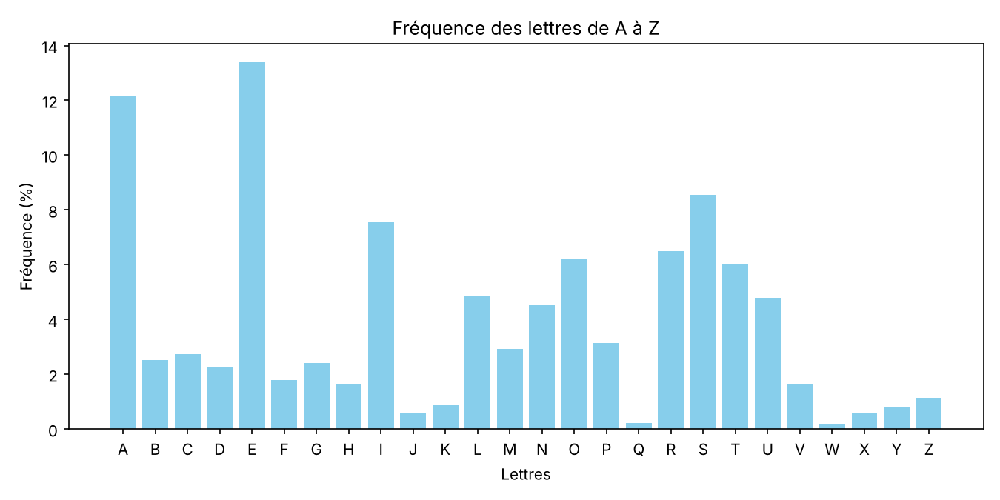

# 🟩🟨⬜ Résolution et optimisation du jeu Wordle

> **TIPE 2024 — Thème : Jeux et Sports** · *Arwa Zouhal*
> Étude du jeu Wordle (version française, mots de 5 lettres) : analyse du problème, statistiques sur le dictionnaire, choix d'un « mot pivot » et programmation d'un solveur.


---

## 📌 Sommaire

1. [Le jeu](#-le-jeu)
2. [Problématique](#-problématique)
3. [Démarche](#-démarche)
4. [Résultats](#-résultats)
5. [Structure du dépôt](#-structure-du-dépôt)
6. [Installation et utilisation](#-installation-et-utilisation)
7. [Limites et pistes d'amélioration](#-limites-et-pistes-damélioration)
8. [Présentation du TIPE](#-présentation-du-tipe)

---

## 🎮 Le jeu

Wordle consiste à **deviner un mot de 5 lettres** en 6 essais maximum. Après chaque proposition, chaque lettre est colorée :

| Couleur | Code | Signification |
|:---:|:---:|---|
| 🟩 Vert | `2` | la lettre est bonne et bien placée |
| 🟨 Jaune | `1` | la lettre est dans le mot mais mal placée |
| ⬜ Gris | `0` | la lettre n'apparaît pas dans le mot |

## ❓ Problématique

> **Comment maximiser les chances de trouver le mot recherché en un minimum de tentatives ?**

Pour chaque mot proposé, il existe 3⁵ = **243 motifs de couleurs** possibles. Le dictionnaire utilisé compte **7 613 mots** de 5 lettres, soit ⌊log₂(7613)⌋ + 1 = **13 bits** d'information à découvrir. Chaque essai doit donc réduire au maximum la liste des mots encore possibles.

## 🧭 Démarche

1. **Reprogrammer le jeu** en Python avec une interface Tkinter (`01_jeu_wordle.py`).
2. **Étudier le dictionnaire** :
   - fréquence de chaque lettre de A à Z (`02`, `08`) ;
   - occurrences de chaque lettre **par position** (`03`, fichier Excel dans `docs/`).
3. **Chercher le mot pivot** : le meilleur premier mot est celui dont les lettres sont les plus fréquentes (`04`).
4. **Programmer un algorithme de résolution** (`05`) qui, à chaque coup :
   1. utilise les indices du coup précédent pour **filtrer** la liste des mots possibles ;
   2. recalcule les fréquences sur la liste réduite et **choisit un nouveau mot pivot**.

Fréquences des lettres dans le dictionnaire (en %) :

| A | B | C | D | **E** | F | G | H | I | J | K | L | M |
|---|---|---|---|---|---|---|---|---|---|---|---|---|
| 12,15 | 2,52 | 2,74 | 2,27 | **13,39** | 1,79 | 2,40 | 1,62 | 7,54 | 0,61 | 0,87 | 4,85 | 2,93 |

| N | O | P | Q | R | **S** | T | U | V | W | X | Y | Z |
|---|---|---|---|---|---|---|---|---|---|---|---|---|
| 4,53 | 6,21 | 3,15 | 0,22 | 6,48 | **8,56** | 6,02 | 4,78 | 1,62 | 0,18 | 0,61 | 0,82 | 1,13 |



## 📊 Résultats

Le solveur a été testé sur **les 7 613 mots** du dictionnaire (chaque mot est la cible une fois), avec le calcul de couleurs officiel de Wordle (`src/07_benchmark.py`) :

| Premier mot | Essais moyens | Réussite en ≤ 6 essais |
|---|:---:|:---:|
| `AEREE` (score = somme des fréquences, doublons inclus, comme dans le TIPE) | 4,71 | 89,4 % |
| `AIRES` (score sur les lettres **distinctes**) | **4,37** | **92,8 %** |

**À retenir :** un premier mot avec des lettres répétées (`AEREE`) apporte moins d'information qu'un mot à 5 lettres différentes (`AIRES`). Le calcul « lettres distinctes » utilisé pour les coups suivants (`set(mot)`) est donc le bon choix dès le premier coup.

## 🗂 Structure du dépôt

```
wordle-tipe/
├── README.md
├── requirements.txt
├── data/
│   └── mots.txt                     # dictionnaire : 7 613 mots de 5 lettres
├── docs/
│   ├── TIPE_24.pdf                  # présentation du TIPE
│   ├── TIPE_24.pptx
│   ├── OCCURRENCES_DES_LETTRES.xlsx # lettres par position (tableau)
│   └── frequences_lettres.png
└── src/
    ├── 01_jeu_wordle.py             # le jeu (Tkinter) : WordleGame + WordleApp
    ├── 02_calcul_probabilites.py    # probabilité d'un mot d'après les fréquences
    ├── 03_occurrences_par_position.py  # occurrences des lettres par position
    ├── 04_mot_pivot.py              # meilleur premier mot (score par fréquences)
    ├── 05_solveur_interactif.py     # solveur du TIPE (Tkinter) : filtre + nouveau pivot
    ├── 06_solveur_ameliore.py       # solveur en ligne de commande (couleurs exactes)
    ├── 07_benchmark.py              # test sur tout le dictionnaire
    ├── 08_graphique_frequences.py   # histogramme des fréquences
    └── wordle_core.py               # fonctions communes (retour, filtre, pivot)
```

## 🚀 Installation et utilisation

```bash
git clone https://github.com/Arwa-Zouhal/wordle-tipe.git
cd wordle-tipe
pip install -r requirements.txt   # seulement pour le graphique
```

| Je veux… | Commande |
|---|---|
| Jouer à Wordle | `python src/01_jeu_wordle.py` |
| Voir le meilleur premier mot | `python src/04_mot_pivot.py` |
| Voir les occurrences par position | `python src/03_occurrences_par_position.py` |
| Utiliser le solveur du TIPE (cible aléatoire) | `python src/05_solveur_interactif.py` |
| Me faire aider sur un vrai Wordle | `python src/06_solveur_ameliore.py` |
| Mesurer les performances du solveur | `python src/07_benchmark.py` (ou `... AEREE`) |
| Regénérer le graphique | `python src/08_graphique_frequences.py` |

**Utiliser `06_solveur_ameliore.py`** : le programme propose un mot, tu le joues sur Wordle, puis tu saisis le retour en 5 chiffres (`0` gris, `1` jaune, `2` vert). Exemple : `02010`.

> `tkinter` est inclus avec Python. Sous Linux : `sudo apt install python3-tk`.

## 🔧 Limites et pistes d'amélioration

- **Lettres répétées** : le solveur du TIPE (`05`) colore en jaune toute lettre présente ailleurs dans le mot, même si elle est déjà utilisée (ex. `AEREE` sur `BEDON`). Sur un vrai Wordle, ce n'est pas le retour officiel ; `wordle_core.retour()` gère ce cas.
- **Dictionnaire** : les scripts d'origine recopient la liste de mots dans chaque fichier. La version propre se trouve dans `data/mots.txt`.
- **Stratégie** : le mot pivot maximise la fréquence des lettres, pas l'information réellement gagnée. Piste : choisir le mot qui **minimise le nombre moyen de mots restants** ou **maximise l'entropie** sur les 243 motifs possibles.
- **Interface** : le jeu `01` n'affiche que le dernier essai et ne vérifie pas que le mot saisi existe dans le dictionnaire.

## 🎓 Présentation du TIPE

Le support de présentation est disponible dans [`docs/TIPE_24.pdf`](docs/TIPE_24.pdf).

---

*Projet réalisé par **Arwa Zouhal** — TIPE 2024.*
